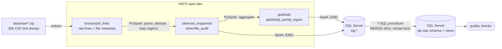

# Peru Job Ads Pipeline

**ES —** Pipeline ETL de punta a punta con datos reales: ~1 millón de enlaces de avisos de empleo
descargados de cuatro portales peruanos (Computrabajo, Bumeran, Buscotrabajo, Mipleo) entre junio 2023
y febrero 2024. Los archivos crudos se cargan en **HDFS**, se transforman con **PySpark** en capas
bronze → silver → gold, se cargan en un modelo estrella en **SQL Server** y todo se orquesta con
**Airflow**. Corre completo con `docker compose` (o en GitHub Codespaces, sin instalar nada).

**EN —** End-to-end ETL pipeline on real data: ~1M job-ad links scraped from four Peruvian job portals.
Raw files land in **HDFS**, are transformed with **PySpark** (bronze → silver → gold), loaded into a
**SQL Server** star schema, and orchestrated with **Airflow**.

---

## Architecture



Airflow DAG `job_ads_pipeline`:

```
extract_raw_files → bronze_ingest → silver_transform → gold_build → load_staging → publish_star_schema → quality_checks
                                                 sqlserver_init_schema ──┘
```

| Layer | Where | Content |
|---|---|---|
| Bronze | `hdfs:///lake/bronze/job_links` | Every raw line, unchanged, with source file, portal, snapshot date; partitioned by portal/date |
| Silver | `hdfs:///lake/silver/ad_snapshots` | One row per ad per snapshot: `ad_id`, title, location, region |
| Silver | `hdfs:///lake/silver/file_audit` | Per-file line counts: ads, navigation links, junk, unparsed, duplicates |
| Gold | `hdfs:///lake/gold/ads` | One row per ad: first/last seen, snapshots, days visible, censoring flag |
| Gold | `hdfs:///lake/gold/daily_portal_region` | Ads listed and new ads by date × portal × region |
| Warehouse | SQL Server `dw.*` | `dim_portal`, `dim_region`, `dim_date`, `dim_ad`, `fact_ad_snapshot`, `fact_daily_listing`, `file_audit` |

## The data

Each portal encodes the ad differently in its URL, so each needs its own parser
([src/jobads/parsers.py](src/jobads/parsers.py)):

| Portal | Example link | Extracted |
|---|---|---|
| Computrabajo | `/ofertas-de-trabajo/oferta-de-trabajo-de-supervisor-de-marketing-en-santiago-de-surco-A8CA28F9363686ED61373E686DCF3405#lc=...` | title, district, 16-hex id |
| Bumeran | `/empleos/help-desk-csti-corp-1115857027.html` | title (+company), numeric id |
| Buscotrabajo | `/se-busca-nana-ninera-en-arequipa-ID-10512881` | title, city/region, numeric id |
| Mipleo | `https://www.mipleo.com.pe/ofertas-de-trabajo/oferta-de-trabajo-en-ancash/...-5144705.html` | title, region, numeric id |

| Portal | Files | Period | Ad links | Unique ads |
|---|---:|---|---:|---:|
| Computrabajo | 131 | 2023-06-11 → 2024-02-15 | 460,155 | 383,314 |
| Buscotrabajo | 162 | 2023-06-12 → 2024-02-15 | 383,356 | 203,977 |
| Mipleo | 39 | 2023-12-15 → 2024-02-15 | 92,542 | 88,707 |
| Bumeran | 64 | 2023-06-11 → 2024-02-15 | 82,661 | 76,702 |
| **Total** | **396** | | **1,018,714** | **752,700** |

Data issues the pipeline handles:

- **Two id formats in Computrabajo** — most ids are 32 hex chars, some 16; the extra 16 are a constant
  suffix, so ids are normalized to the first 16 to keep the same ad matched across days.
- **Non-ad lines** — pagination links (`?page=2`), empty lines and placeholder headers (`0`, `""`) are
  classified and counted in `file_audit`, not silently dropped.
- **Inconsistent file names** — `2023_11_2_...` vs `2023_11_02_...`.
- **Daily and weekly snapshots mixed** — kept as `snapshot_freq`.
- **Duplicates inside a snapshot** — the same ad on overlapping result pages is kept once.
- **Locations** — 660 district/city slugs mapped to Peru's 25 regions + Callao through a seed table
  ([seeds/location_region.csv](seeds/location_region.csv)); covers 99.7% of rows. Ambiguous names
  (e.g. `santa-rosa`, which exists in several regions) stay `unmapped` on purpose.
- **Links without a location** — Bumeran URLs carry no location at all, so its ads get the region
  `not_provided`; they are not counted as `unmapped` by the quality gates.

## Results

What a full run produces in SQL Server (database `jobads`, schema `dw`). Numbers below are from a run on
the complete dataset.

### Warehouse

| Table | Rows | Grain |
|---|---:|---|
| `dw.dim_ad` | 752,700 | One row per unique ad: title, location, region, first/last seen, days visible, censoring flag |
| `dw.fact_ad_snapshot` | 987,869 | One row per ad per snapshot date it was listed |
| `dw.fact_daily_listing` | 7,416 | Ads listed and new ads per date × portal × region |
| `dw.dim_region` | 29 | 25 regions + Callao, plus `unmapped` and `not_provided` |
| `dw.file_audit` | 394 | Line counts and data-quality figures per source file |

### Where are the jobs? — `dw.v_region_share`

Top 10 regions, all portals, ads with a known location:

| Region | Ads | Share |
|---|---:|---:|
| Lima | 479,291 | 70.9% |
| Arequipa | 40,920 | 6.1% |
| La Libertad | 25,577 | 3.8% |
| Piura | 16,795 | 2.5% |
| Ica | 14,503 | 2.1% |
| Lambayeque | 13,294 | 2.0% |
| Junín | 12,043 | 1.8% |
| Callao | 8,875 | 1.3% |
| Áncash | 7,821 | 1.2% |
| Cajamarca | 7,545 | 1.1% |

Lima + Callao share by portal: Mipleo 76.8%, Computrabajo 76.2%, Buscotrabajo 62.6% — Buscotrabajo is the
most regional of the four. Bumeran is left out (no location in its links).

### How long do ads stay online? — `dw.v_ad_duration_by_portal`

Only uncensored ads (first and last appearance both inside the scraping window):

| Portal | Ads | Avg days visible | Max days | Seen in a single snapshot |
|---|---:|---:|---:|---:|
| Computrabajo | 366,073 | 1.8 | 237 | 84.3% |
| Buscotrabajo | 199,817 | 2.3 | 61 | 86.1% |
| Mipleo | 85,814 | 1.0 | 2 | 95.6% |
| Bumeran | 67,223 | 2.7 | 241 | 94.4% |

Most ads appear in only one snapshot, so these durations mostly reflect how often each portal was
scraped, not true posting lifetimes (see [Limitations](#limitations)).

### New ads per month — `dw.v_new_ads_monthly`

| Month | Computrabajo | Buscotrabajo | Mipleo | Bumeran | Total | Snapshots (CT / BT / MP / BU) |
|---|---:|---:|---:|---:|---:|---|
| 2023-06 | 24,709 | 5,536 | – | 6,193 | 36,438 | 3 / 14 / – / 3 |
| 2023-07 | 47,235 | 8,324 | – | 13,029 | 68,588 | 4 / 16 / – / 4 |
| 2023-08 | 53,015 | 22,415 | – | 14,527 | 89,957 | 18 / 20 / – / 5 |
| 2023-09 | 28,526 | 15,458 | – | 5,792 | 49,776 | 12 / 13 / – / 2 |
| 2023-10 | 45,240 | 18,525 | – | 6,317 | 70,082 | 18 / 19 / – / 2 |
| 2023-11 | 53,461 | 26,443 | – | 0 | 79,904 | 20 / 23 / – / 0 |
| 2023-12 | 51,973 | 41,567 | 25,397 | 7,033 | 125,970 | 25 / 26 / 15 / 16 |
| 2024-01 | 49,596 | 51,572 | 60,417 | 10,872 | 172,457 | 23 / 24 / 23 / 24 |
| 2024-02 | 16,415 | 12,027 | 389 | 4,035 | 32,866 | 7 / 7 / 1 / 7 |

Each portal's first snapshot is excluded (every ad on it would count as new). Monthly totals follow the
number of snapshots taken, so compare months only alongside the snapshot column: the Dec–Jan jump is
mostly Mipleo joining and daily scraping, and February stops on the 15th.

### Most frequent job titles — `dw.v_top_titles`

Top 3 per portal (titles come from URL slugs; long ones shortened here):

| Portal | # | Title | Ads |
|---|---:|---|---:|
| Buscotrabajo | 1 | asistente contable | 618 |
| | 2 | asistente administrativo | 602 |
| | 3 | operario de limpieza | 405 |
| Computrabajo | 1 | 50 operarios de limpieza c/s experiencia bono de S/130 … | 420 |
| | 2 | asistente contable | 362 |
| | 3 | 50 operarios de limpieza con o sin experiencia bono S/130 … | 310 |
| Mipleo | 1 | 50 operarios de limpieza c/s experiencia bono de S/130 … | 398 |
| | 2 | comisiona ilimitado trabajando como asesor de ventas centro de lima | 145 |
| | 3 | asistente contable | 137 |
| Bumeran | 1 | home office asesores de cobranzas … v v soluciones sac | 100 |
| | 2 | asesor de cobranzas planilla completa comisiones … v v soluciones sac | 97 |
| | 3 | vendedores y promotores | 82 |

Accounting assistants, administrative assistants and cleaning staff lead on the general portals; one
mass cleaning-staff campaign is reposted many times across Computrabajo and Mipleo, and a single
collections company dominates Bumeran's top titles.

## Data quality

Two gates stop the pipeline if quality drops:

1. **Spark (silver)** — fails if unparsed lines > 0.5%, any file yields no ads, or unmapped regions > 2%.
2. **SQL Server (after load)** — [sql/04_quality_checks.sql](sql/04_quality_checks.sql): row counts
   staging vs warehouse, ads without snapshots, `last_seen < first_seen`, `n_snapshots` consistency,
   daily totals vs snapshot rows, per-file unparsed share, unmapped-region share.

## Design choices

- **Idempotent by construction** — HDFS writes use dynamic partition overwrite, staging is truncate-loaded,
  dimensions are upserted with `MERGE` (stable surrogate keys) and facts are reloaded in one transaction.
  Any task can be retried or the whole DAG re-run without duplicates.
- **One parser, tested once** — URL parsing is plain Python with unit tests, used inside Spark as a UDF.
  Native `regexp_extract` would be faster, but at ~1M rows the UDF costs seconds and avoids keeping two
  copies of the rules.
- **Censoring** — ads already listed on a portal's first snapshot or still listed on its last one have an
  unknown duration; they are flagged (`is_censored`) and excluded from duration statistics.
- **Sized for a laptop/Codespace** — Spark runs in local mode inside the Airflow container, HDFS is a single
  NameNode + DataNode, SQL Server is the Express edition. The same jobs run on a cluster by changing
  `--master` and `LAKE_ROOT`.

## Run it

### Option A — GitHub Codespaces (nothing to install)

1. On the repository page: **Code → Codespaces → Create codespace** (uses a 4-core / 16 GB machine).
2. In the Codespace terminal:
   ```bash
   docker compose up -d --build      # first build ~5 min
   ```
3. Open the **Ports** tab → port **8080** (Airflow, user `admin` / `admin`).
   Port **9870** shows the HDFS web UI.
4. In Airflow, un-pause `job_ads_pipeline` and click **Trigger DAG**.

### Option B — any machine with Docker (≥ 12 GB RAM recommended)

```bash
git clone https://github.com/Ayrton1931/peru-job-ads-pipeline.git
cd peru-job-ads-pipeline
docker compose up -d --build
```

### Query the warehouse

```bash
docker compose exec sqlserver /opt/mssql-tools18/bin/sqlcmd -S localhost -U sa -P 'JobAds#Local2024' -C -d jobads \
  -Q "SELECT * FROM dw.v_ad_duration_by_portal"
```

Views: `dw.v_new_ads_monthly`, `dw.v_ad_duration_by_portal`, `dw.v_region_share`, `dw.v_top_titles`.

### Unit tests

```bash
pip install pytest && pytest -q
```

## Repository layout

```
airflow/dags/job_ads_pipeline.py   Airflow DAG
spark_jobs/                        PySpark jobs: bronze_ingest, silver_transform, gold_build, load_sqlserver
src/jobads/parsers.py              URL parsers (one per portal)
src/jobads/db.py                   SQL Server helpers (schema, publish, quality checks)
sql/                               DDL, load procedure, views, quality checks (T-SQL)
seeds/location_region.csv          district/city → region mapping
data/raw/*.zip                     raw link dumps, one archive per portal
docker/, docker-compose.yml        Airflow image (Spark + Java), Hadoop config
.devcontainer/                     Codespaces configuration
tests/                             parser unit tests
```

## Limitations

- Links only: the ad text (salary, requirements) was not scraped, so titles come from URL slugs.
- Bumeran slugs mix job title and company name; they are not separated.
- Snapshots are not daily for every portal and date, so `days_visible` is an approximation bounded by
  the scraping calendar.
- Local credentials (`admin/admin`, SQL `sa` password) are for the demo only.
